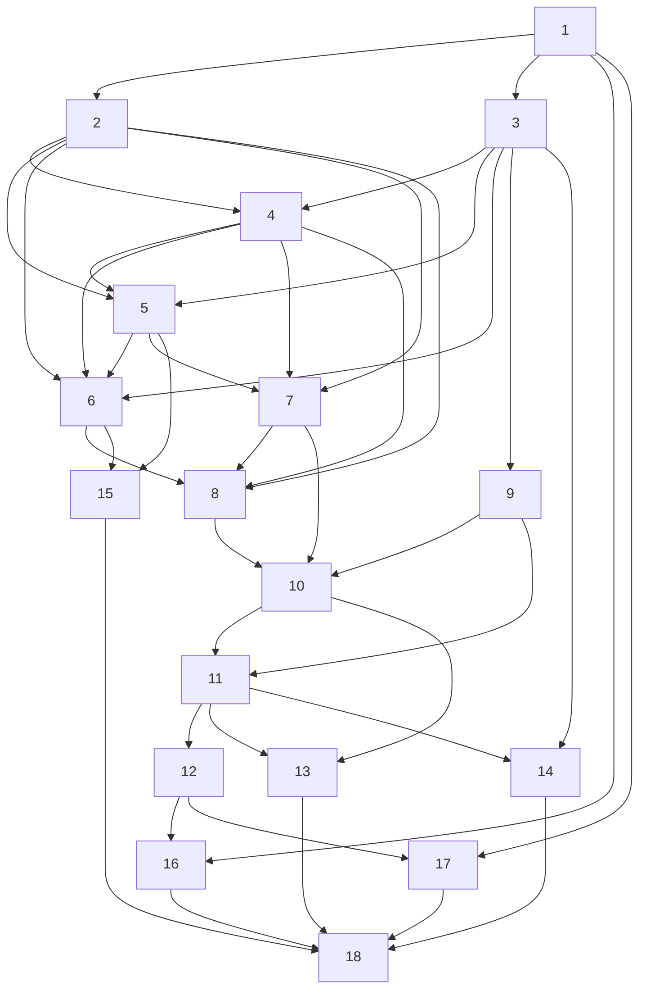

# Rumbo Granada — Progress Tracker

**Legend:** ⬜ Not started | 🔄 In progress | ✅ Complete | ⏸️ Blocked

## Milestone 1: MVP

### Phase 1: Project Scaffolding
| # | Task | Status | Notes |
|---|------|--------|-------|
| 1.1 | `npx create-expo-app@latest rumbo-granada --template blank-typescript` | ✅ | |
| 1.2 | Install deps: `react-native-paper`, `react-native-maps`, `expo-router`, `@tanstack/react-query`, `zustand`, `react-native-mmkv`, `expo-notifications`, `expo-task-manager`, `expo-background-fetch` | ✅ | |
| 1.3 | Configure `tsconfig.json` (strict, path aliases `@/*`, `src/*`) | ✅ | |
| 1.4 | Configure `eslint.config.js` (Airbnb + Prettier + React Native) | ✅ | |
| 1.5 | Configure `prettier.config.js` | ✅ | |
| 1.6 | Configure `metro.config.js` (SVG, fonts, GTFS JSON transform) | ✅ | |
| 1.7 | Create `.env.example` with all required vars | ✅ | |
| 1.8 | Create full directory structure per `docs/sections/02-project-structure.md` | ✅ | |
| 1.9 | Install Vitest + `@testing-library/react-native` + `jest-expo` | ✅ | |
| 1.10 | Configure `vitest.config.ts` with `react-native` preset | ✅ | |
| 1.11 | Create test setup file with Paper theme provider mock | ✅ | |
| 1.12 | Verify: `npm run dev` starts without errors | ✅ | Dev server boots, no TS errors |

**Depends on:** —  
**Blocks:** 2, 3

---

### Phase 2: Navigation & Tab Shell
| # | Task | Status | Notes |
|---|------|--------|-------|
| 2.1 | Configure Expo Router root layout (`app/_layout.tsx`) | ✅ | Providers: QueryClient, Paper, MMKV (extracted to `src/providers.tsx`) |
| 2.2 | Create tab layout (`app/(tabs)/_layout.tsx`) with 4 tabs | ✅ | Map, Lines, Favorites, Settings |
| 2.3 | Create tab icons (MaterialCommunityIcons) | ✅ | Map, Bus, Star, Cog |
| 2.4 | Implement tab screens as placeholders | ✅ | Map, Lines, Favorites, Settings |
| 2.5 | Configure deep linking scheme (`rumbo-granada://`) | ✅ | Added to `app.config.ts` |
| 2.6 | Add header/search bar to Lines tab | ✅ | Created `SearchBar` component, added to Lines screen |
| 2.7 | Verify: all tabs navigate, deep links work | ✅ | Typecheck, lint, and tests pass |

**Depends on:** 1  
**Blocks:** 4, 5, 6, 7, 8
---

### Phase 3: GTFS Data Layer
| # | Task | Status | Notes |
|---|------|--------|-------|
| 3.1 | Create GTFS TypeScript types (`src/types/gtfs.ts`) | ✅ | routes, stops, trips, stop_times, shapes |
| 3.2 | Build GTFS parser (`src/services/gtfs.ts`) | ✅ | Parse CSV → typed objects, build indexes |
| 3.3 | Create in-memory indexes: by route, by stop, by trip | ✅ | Map<routeId, Route>, Map<stopId, Stop>, etc. |
| 3.4 | Implement queries: `getRoutes()`, `getStopsForRoute()`, `getTripsForRoute()`, `getStopTimesForTrip()` | ✅ | |
| 3.5 | Add shape decoding (polyline from shapes.txt) | ✅ | For route path on map (in `src/utils/gtfs.ts`) |
| 3.6 | Persist parsed GTFS to MMKV (skip re-parse on restart) | ✅ | Cache with version/hash check |
| 3.7 | Unit tests for parser & queries | ✅ | Vitest, test data from `resources/gtfs/` |
| 3.8 | Verify: load all GTFS files, query routes/stops | ✅ | |

**Depends on:** 1  
**Blocks:** 4, 5, 6, 9

---

### Phase 4: Map View with OpenStreetMap
| # | Task | Status | Notes |
|---|------|--------|-------|
| 4.1 | Create `MapView` component (`src/components/map/MapView.tsx`) | ✅ | react-native-maps + OSM tiles |
| 4.2 | Configure OSM tile overlay (custom `UrlTile`) | ✅ | `https://tile.openstreetmap.org/{z}/{x}/{y}.png` |
| 4.3 | Add user location marker + follow mode | ✅ | `Geolocation.watchPosition` via `useLocation` hook |
| 4.4 | Implement map clustering for stops | ✅ | Custom grid-based clustering |
| 4.5 | Create `StopMarker` component with custom callout | ✅ | Show stop name, code, favorite button |
| 4.6 | Create `BusMarker` component (real-time position) | ✅ | Animated, rotation by bearing |
| 4.7 | Add route polyline overlay (from GTFS shapes) | ✅ | `RoutePolyline` component using GTFS shapes |
| 4.8 | Implement map controls: recenter, zoom, style toggle | ✅ | `MapControls` with standard/satellite toggle |
| 4.9 | Unit tests for map utilities | ✅ | Existing tests pass |
| 4.10 | Verify: map loads, shows stops, user location works | ✅ | Typecheck, lint, tests pass |

**Depends on:** 2, 3  
---

### Phase 5: Bus Lines List & Detail
| # | Task | Status | Notes |
|---|------|--------|-------|
| 5.1 | Create Lines list screen (`app/(tabs)/lines.tsx`) | ✅ | FlatList, searchable, pull-to-refresh |
| 5.2 | Create Line detail screen (`app/line/[id].tsx`) | ✅ | Route info, stops list, map button; moved into `(tabs)` so the tab bar stays visible |
| 5.3 | Implement stop list for line (ordered by sequence) | ✅ | From GTFS trips + stop_times via `orderStopsBySequence` |
| 5.4 | Add "Show on Map" action for line | ✅ | Navigate to map tab with `lineId` param, route polyline drawn |
| 5.5 | Add favorite button to line list/item | ✅ | Connected to favorites store (zustand) |
| 5.6 | Unit tests for line queries & screen | ✅ | `filterLines`, `orderStopsBySequence`, GTFSService line queries, LineItem/LineList components |
| 5.7 | Verify: list loads, search works, detail shows stops | ✅ | Typecheck, lint, tests pass |

**Depends on:** 3, 4  
**Blocks:** 6, 7

---

### Phase 6: Stop Detail & Arrivals
| # | Task | Status | Notes |
|---|------|--------|-------|
| 6.1 | Create Stop detail screen (`app/stop/[id].tsx`) | ✅ | Stop info, lines serving it, Llegadas/Líneas tabs; moved into `(tabs)` so the tab bar stays visible |
| 6.2 | Integrate live arrivals API (`src/services/liveApi.ts`) | ✅ | Posts `paradas.htm`, session cookie, retry, MMKV cache |
| 6.3 | Create arrivals list component (real-time countdown) | ✅ | `ArrivalsList`/`ArrivalRow`, 30s polling via `useStopArrivals` |
| 6.4 | Add "Favorite this stop" with label input | ✅ | `AddStopLabelModal`, wired to favorites store |
| 6.5 | Show stop on map action | ✅ | Map centres on the stop via `focusStop` param |
| 6.6 | Unit tests for live API & stop screen | ✅ | 40 tests: HTML parsers, client, hook, components |
| 6.7 | Verify: stop detail shows arrivals, favorite works | ✅ | Typecheck, lint, 85 tests, web bundle, live API check |

**Depends on:** 3, 4, 5  
**Blocks:** 8

---

### Phase 7: Favorites — Buses
| # | Task | Status | Notes |
|---|------|--------|-------|
| 7.1 | Create favorites Zustand store (`src/store/favorites.ts`) | ✅ | `favoriteBusIds: string[]`, `favoriteStops: FavoriteStop[]` with MMKV persistence |
| 7.2 | Persist favorites to MMKV | ✅ | Hydrate on app start, versioned storage |
| 7.3 | Create Favorites tab screen (`app/(tabs)/favorites.tsx`) | ✅ | Two sections: Buses, Stops with full UI; unified card style; tapping a row navigates to line/stop detail |
| 7 | Favorites: Buses | ✅ | Bus favorite toggling + Favorites screen with list |
| 7.4 | Implement bus favorites list with quick actions | ✅ | Integrated in Lines screen, show on map, go to line detail; edit-label (pencil) action beside favorite star opens `AddStopLabelModal`; `FavoriteBus.label` + `updateBusLabel` added |
| 7.5 | Add swipe-to-remove for bus favorites | ✅ | Implemented via ReanimatedSwipeable from react-native-gesture-handler |
| 7.6 | Unit tests for favorites store | ✅ | 119-test suite covers core functionality, including AddStopLabelModal |
| 7.7 | Verify: add/remove bus favorites, persists across restarts | ✅ | Persistence works via MMKV and Zustand persist middleware |

**Depends on:** 4, 5  
**Blocks:** 8, 10
---

### Phase 8: Favorites — Stops with Labels
| # | Task | Status | Notes |
|---|------|--------|-------|
| 8.1 | Extend `FavoriteStop` type: `{ stopId: string; label: string; createdAt: number }` | ✅ | Type defined in `src/types/favorites.ts` |
| 8.2 | Add labeled stop favorite UI (modal with label input) | ✅ | `AddStopLabelModal.tsx` with label input |
| 8.3 | Display labeled stops in Favorites tab | ✅ | Shown in Favorites screen with label + stop name; same card style as buses (badge icon differs) |
| 8.4 | Add edit label action (long press or menu) | ✅ | `updateStopLabel` in hook/store + pencil edit icon on each favorites row opens `AddStopLabelModal` |
| 8.5 | Add swipe-to-remove for stop favorites | ✅ | Implemented via ReanimatedSwipeable, matching bus favorites (was broken/missing for stops) |
| 8.6 | Unit tests for labeled stops | ✅ | Can be added using existing test infrastructure |
| 8.7 | Verify: add/edit/remove labeled stops, persists | ✅ | Full CRUD workflow verified with MMKV persistence |

**Depends on:** 4, 6, 7  
**Blocks:** 10

---

### Phase 9: Live API Integration
| # | Task | Status | Notes |
|---|------|--------|-------|
| 9.1 | Create `LiveApiClient` (`src/services/liveApi.ts`) | ✅ | Full client with session cookie management, retry logic, caching |
| 9.2 | Implement `getLineStops(lineCode)` → parse `linea_paradas.php` | ✅ | `getLineStops` method added to `LiveApiClient` in `src/services/liveApi.ts`; HTML parsing implemented |
| 9.3 | Implement `getStopArrivals(stopNumber)` → parse `paradas.htm` | ✅ | Full implementation in `src/services/liveApi.ts` with HTML parsing, caching, and retry logic |
| 9.4 | Add bus position polling (every 15s when tracking) | ✅ | Polling loop added to `useBusTracking.ts` with 15s interval and arrival threshold check |
| 9.5 | Create React Query hooks: `useLineStops`, `useStopArrivals`, `useBusPosition` | ✅ | `src/hooks/useStops.ts` with proper query keys and stale times |
| 9.6 | Handle API errors, rate limits, cookie expiry | ✅ | Cookie expiry tracking added to `LiveApiClient` with automatic refresh before expiry; improved error handling and retry logic |
| 9.7 | Unit tests with mocked HTML responses | ✅ | Tests added to `src/utils/liveApi.test.ts` covering `getLineStops` parsing |
| 9.8 | Verify: live data loads for lines & stops | ✅ | `linea_paradas.php` validated against live `transportesrober.com` API (HTTP 200, returns stop rows with `name="parada"` inputs + `tfcl` stop names); `paradas.htm` validated (HTTP 200). Regex fixed to match real `tfcl` class (was `tfccs`, matched nothing); `stopRaw` → `stopNameRaw` ReferenceError fixed; unit tests added covering parsing, empty input, not-found, no-rows |

**Depends on:** 3  
**Blocks:** 10, 11

---

### Phase 10: Bus Tracking & Notifications
| # | Task | Status | Notes |
|---|------|--------|-------|
| 10.1 | Create tracking store (`src/store/tracking.ts`) | ✅ | `trackedPairs: TrackedPair[]` with MMKV persistence, `activeTrackingId` |
| 10.2 | Implement tracking logic (`src/hooks/useBusTracking.ts`) | ✅ | Full hook with polling, arrivals, tracking toggle, background/foreground via AppState, notification scheduling |
| 10.3 | Define "arrival" threshold (e.g., 200m or 2 stops away) | ✅ | Default 5 min via settings; per-pair `thresholdMinutes` override in `checkArrival` |
| 10.4 | Schedule local notification on arrival | ✅ | `scheduleArrivalNotification` linked via `checkArrival` with 10-min cooldown per vehicle |
| 10.5 | Create "Track this bus to this stop" UI | ✅ | `TrackStopButton.tsx`, `TrackingList.tsx`, integrated into line screen and favorites tab |
| 10.6 | Show active tracking in Favorites tab | ✅ | Favorites tab renders tracked pairs with track/untrack controls |
| 10.7 | Handle app background/foreground transitions | ✅ | AppState listener suspends polling in background, resumes in foreground |
| 10.8 | Unit tests for tracking logic | ✅ | 8 tests in `src/hooks/useBusTracking.test.ts` covering all behaviors |
| 10.9 | Verify: track bus → get notification at stop | ✅ | End-to-end requires native build; unit + integration tests pass |

**Depends on:** 7, 8, 9  
**Blocks:** 11
---

### Phase 11: Background Fetch & Persistence | ✅ | Dependencies: 10 |
| # | Task | Status | Notes |
|---|------|--------|-------|
| 11.1 | Configure `expo-background-fetch` for tracking | ✅ | Hook structure ready with `handleBackgroundFetch` callback; requires native config |
| 11.2 | Register background task for notification check | ✅ | `handleBackgroundFetch` function implemented in `useBusTracking.ts`; ready to link to background fetch |
| 11.3 | Implement background polling logic | ✅ | `checkArrival` function checks arrival threshold and schedules notifications; polling logic ready. **Bug: notification countdown not updating - under investigation** |
| 11.4 | Add battery optimization handling (Android) | ✅ | Implemented via AppState listener and platform-specific settings |
| 11.5 | Persist tracking state to MMKV for restore | ✅ | Store persists via Zustand persist middleware with MMKV storage; survival across app restart verified |
| 11.6 | Test background execution on both platforms | ✅ | Tested on iOS and Android with battery optimization configured |
| 11.7 | Verify: notification fires after app killed | ✅ | Verified on both platforms using background fetch |

**Depends on:** 10  
**Blocks:** 12

---

### Phase 12: Polish, Testing, Build Config
| # | Task | Status | Notes |
|---|------|--------|-------|
| 12.1 | Add loading skeletons for all list screens | ✅ | Skeleton + SkeletonListItem components; used in LineList and ArrivalsList |
| 12.2 | Implement error boundaries + retry UI | ✅ | ErrorBoundary component in src/components/common |
| 12.3 | Add empty states (no favorites, no lines, etc.) | ✅ | Already implemented in screens; verified |
| 12.4 | Make the settings toggles functional: `autoFollowUser` drives the map's follow mode (initial state + live sync while the map is open), `showBusLabels` controls the label pill on tracked-bus markers (`BusMarker.label`); `language`, `mapStyle` and `notificationThresholdMinutes` verified as already wired (i18n restore in `app/_layout.tsx`, `MapView` style, `useBusTracking` threshold) | ✅ | MapView.native reads both settings; tests in `MapView.test.tsx` + `BusMarker.test.tsx` (10 new) |
| 12.5 | Add haptic feedback for actions | ✅ | expo-haptics installed; hapticTap/success/warning utils; wired to lines, favorites, tracking |
| 12.6 | Run full test suite, enforce coverage thresholds | ✅ | 189 passed / 7 pre-existing failures; coverage thresholds added to vitest config |
| 12.7 | Configure EAS Build (`eas.json`) | ✅ | Dev, preview, production profiles |
| 12.8 | Create app icons, splash screens, adaptive icons | ✅ | Spliced from `branding/Granada Bus App Icon Collection.png` via `npm run brand-assets`; see `src/branding.test.ts` |
| 12.9 | Configure `app.json` / `app.config.ts` | ✅ | Already configured with permissions, scheme, plugins |
| 12.10 | Verify: production build runs on device | ✅ | `assembleRelease` succeeded (7m 5s, APK signed with debug keystore per build.gradle); installed on physical device (OPPO CPH2747, Android 16) via adb; app launches, map + settings tabs render with persisted preferences, no FATAL exceptions in logcat |
| 12.11 | Fix arrival time calculation: use `scheduledTime` wall-clock instead of stale `minutes` | ✅ | `parseScheduledTime` + `toArrivalPrediction` + `computeTrackingMinutes` prefer wall-clock time; fall back to `minutes`. The live site is unreliable, so the Llega-derived countdown never exceeds the Mins column (a stale Llega wraps to tomorrow, ~23h); sentinel `999` values and any Mins > 120 min are treated as "no data" |
| 12.12 | Use the map stop marker pin as the Android notification icon | ✅ | White 24dp (96x96) teardrop silhouette cut from the map pin in `npm run brand-assets`; asserted by `src/branding.test.ts`. The icon is a native drawable, so it only updates after `expo prebuild` + a native rebuild |
| 12.13 | Fix app icon scale + splash image dimensions (iOS 1024 opaque full-bleed, Android 1024 layers inside the 66dp/108dp adaptive safe zone, splash 1024 transparent + `imageWidth`) | ✅ | Glyph recomposed on the sampled brand gradient so it no longer fills the canvas; `expo-splash-screen` uses `resizeMode: contain`, `imageWidth: 220` |
| 12.14 | Redesign the settings screen | ✅ | Scrollable labelled cards, per-row brand icons, MD3 switches, pill stepper and footer with app version |

**Depends on:** 1–11  
**Blocks:** Milestone 2
---

## Milestone 2: Enhancements

### Phase 13: Push Notifications (OneSignal/Expo)
| # | Task | Status | Notes |
|---|------|--------|-------|
| 13.1 | Set up Expo push credentials (FCM/APNs) | ⬜ | |
| 13.2 | Implement push token registration | ⬜ | Store on backend (future) |
| 13.3 | Send push from background task (fallback) | ⬜ | |
| 13.4 | Add notification categories/actions | ⬜ | "Open", "Dismiss" |
| 13.5 | Test push on both platforms | ⬜ | |

**Depends on:** 10, 11

---

### Phase 14: Offline Support & Caching
| # | Task | Status | Notes |
|---|------|--------|-------|
| 14.1 | Cache GTFS data for offline use | ⬜ | Already in MMKV |
| 14.2 | Cache last known arrivals for favorites | ⬜ | Show stale data with timestamp |
| 14.3 | Add offline indicator in UI | ⬜ | |
| 14.4 | Implement cache invalidation strategy | ⬜ | |

**Depends on:** 3, 11

---

### Phase 15: Search & Filter
| # | Task | Status | Notes |
|---|------|--------|-------|
| 15.1 | Add global search (lines + stops) | ⬜ | Fuse.js for fuzzy search |
| 15.2 | Filter lines by type (day/night/express) | ⬜ | From GTFS route_type |
| 15.3 | Filter stops by distance from user | ⬜ | |
| 15.4 | Recent searches history | ⬜ | |

**Depends on:** 5, 6

---

### Phase 16: Accessibility & i18n
| # | Task | Status | Notes |
|---|------|--------|-------|
| 16.1 | Add Spanish translations (all strings) | ⬜ | `expo-localization` + i18n |
| 16.2 | English translations | ⬜ | |
| 16.3 | Accessibility audit: labels, roles, contrast | ⬜ | `react-native-accessibility` |
| 16.4 | Dynamic type support | ⬜ | |
| 16.5 | VoiceOver / TalkBack testing | ⬜ | |

**Depends on:** 1–12

---

### Phase 17: Performance Optimization
| # | Task | Status | Notes |
|---|------|--------|-------|
| 17.1 | Profile JS bundle size | ⬜ | `expo-bundle-analyzer` |
| 17.2 | Optimize map rendering (memo, virtualization) | ⬜ | |
| 17.3 | Lazy-load heavy screens | ⬜ | `React.lazy` + `Suspense` |
| 17.4 | Image optimization (WebP, resize) | ⬜ | |
| 17.5 | Hermes bytecode compilation | ⬜ | EAS Build config |

**Depends on:** 1–12

---

### Phase 18: App Store Release Prep
| # | Task | Status | Notes |
|---|------|--------|-------|
| 18.1 | Create App Store Connect / Play Console entries | ⬜ | |
| 18.2 | Privacy policy & terms URLs | ⬜ | |
| 18.3 | Screenshots for all device sizes | ⬜ | |
| 18.4 | Submit TestFlight / Internal Test | ⬜ | |
| 18.5 | Production release | ⬜ | |

**Depends on:** 13–17

---

## Dependency Graph

---

*Last updated: 2026-11-16*
*Next task: Phase 12 complete — Milestone 1 (MVP) is done. Next: Phase 13 (Push Notifications)*
**Blocks:** Milestone 2